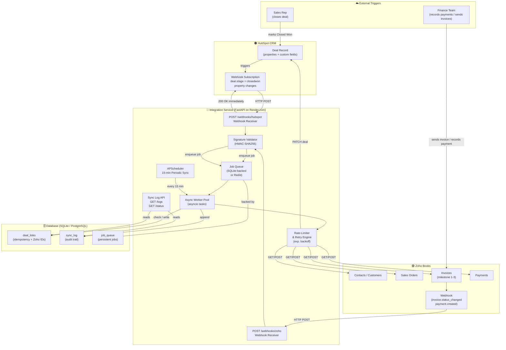

# Architecture: HubSpot ↔ Zoho Books Integration

## System Overview

This integration service acts as a bidirectional synchronisation layer between **HubSpot CRM** and **Zoho Books**. When a sales deal is marked *Closed Won* in HubSpot, the service automatically provisions a matching **Sales Order** and up to three **milestone invoices** in Zoho Books, then writes key financial identifiers back into HubSpot so the sales team has full visibility without ever opening Zoho. Conversely, when Finance records invoice activity (sends, payments, voids) in Zoho Books, the service captures those events via Zoho webhooks and pushes computed progress fields back to the HubSpot deal record. The service is built on **FastAPI** for low-latency webhook ingestion, a **persistent job queue** for reliable asynchronous processing, **APScheduler** for periodic reconciliation polling, and **SQLAlchemy** with SQLite (development) or PostgreSQL (production) for idempotency tracking and event logging.

---

## Architecture Diagram



---

## Component Descriptions

### 1. HubSpot CRM
The system of record for all sales activity. Custom properties (`zoho_so_id`, `zoho_pct_collected`, etc.) are added via the HubSpot Properties API during setup. The CRM fires outbound webhooks on deal stage changes and property updates.

### 2. FastAPI Application (`app/main.py`)
The central HTTP server. It exposes:
- `POST /webhooks/hubspot` — receives and validates HubSpot webhook payloads
- `POST /webhooks/zoho` — receives and validates Zoho Books webhook payloads
- `GET /logs` — returns paginated sync event history
- `GET /status` — health-check endpoint consumed by Render.com

All webhook endpoints **acknowledge immediately** (HTTP 200) and defer all work to the job queue, preventing timeout failures.

### 3. Signature Validator (`app/security.py`)
- **HubSpot**: Validates `X-HubSpot-Signature-v3` using HMAC-SHA256 over the request URI + body + timestamp. Rejects payloads older than 5 minutes.
- **Zoho**: Validates the shared-secret token sent in a custom header.

### 4. Job Queue (`app/queue.py`)
A lightweight persistent queue backed by the `job_queue` database table. Each job carries a type (`sync_deal`, `sync_zoho_event`, `periodic_sync`), a payload, a retry count, and a `run_after` timestamp for exponential-backoff scheduling. Jobs survive service restarts.

### 5. Async Worker Pool (`app/worker.py`)
An `asyncio`-based worker that continuously polls the job queue. It dispatches jobs to typed handlers (`handle_closed_won`, `handle_zoho_invoice_event`, etc.). Failed jobs are re-enqueued with doubled back-off (max 6 hours). After 10 failures, jobs move to a dead-letter state and trigger a Slack/email alert.

### 6. HubSpot Client (`app/hubspot_client.py`)
Wraps the HubSpot Private Apps API. Fetches deals, associated companies and contacts. Patches deal properties. Implements per-call retry with exponential back-off on 429/5xx responses.

### 7. Zoho Books Client (`app/zoho_client.py`)
Manages OAuth 2.0 token refresh automatically (persists `access_token` + expiry in DB). Creates/retrieves customers, sales orders, and invoices. Enforces a token-bucket rate limiter to stay within Zoho's daily API quota. Detects daily quota exhaustion and pauses all jobs until midnight UTC.

### 8. Idempotency Layer (`app/models.py` — `deal_links` table)
| Column | Purpose |
|---|---|
| `hubspot_deal_id` | Primary key |
| `zoho_customer_id` | Zoho contact ID |
| `zoho_so_id` | Sales order ID |
| `zoho_invoice_ids` | Comma-separated invoice IDs |
| `processed_at` | First successful sync timestamp |
| `sync_status` | `pending / synced / error / paused` |

Before creating any Zoho resource, the worker checks `deal_links`. If a record already exists, creation is skipped and only update/sync logic runs.

### 9. APScheduler (`app/scheduler.py`)
Fires a `periodic_sync` job every **15 minutes** for every deal in `deal_links` with `sync_status != 'error_fatal'`. This acts as a safety net for any events missed by webhooks (transient network failures, Zoho webhook delivery failures).

### 10. Sync Log (`app/models.py` — `sync_log` table)
Append-only audit trail of every action taken: webhook received, job enqueued, API call result, property written, error encountered. Exposed via `GET /logs` and rendered as a simple HTML table at the root path.

---

## Security Considerations

| Concern | Mitigation |
|---|---|
| Webhook authenticity | HMAC-SHA256 signature validation on every inbound request; 5-minute replay window |
| Credential storage | All secrets in environment variables; never hard-coded or logged |
| Zoho OAuth tokens | `access_token` stored encrypted in DB; `refresh_token` in environment variable only |
| API key rotation | Client reads from env at startup; rotation requires only env update + service restart |
| HTTPS | Enforced by Render.com's TLS termination; HTTP redirect enabled |
| SQL injection | All DB access via SQLAlchemy ORM with parameterised queries |
| Logging PII | Phone/email values truncated in logs; full values only in encrypted DB |
| Rate-limit abuse | Inbound webhook endpoints have IP-based rate limiting (slowapi) |

---

## Deployment Architecture (Render.com)

```
render.yaml
├── services:
│   ├── type: web          (FastAPI app)
│   │   ├── buildCommand: pip install -r requirements.txt && alembic upgrade head
│   │   └── startCommand:  uvicorn app.main:app --host 0.0.0.0 --port $PORT
│   └── type: worker       (background job worker — optional separate dyno)
│       └── startCommand:  python -m app.worker
└── databases:
    └── type: postgresql   (Render managed Postgres)
```

Environment variables are set via Render's dashboard and injected at runtime. The worker and web service share the same PostgreSQL database. For low-volume deployments (< 50 deals/day), both the FastAPI server and worker run in a single process using `asyncio` background tasks, which avoids the cost of a second dyno.

